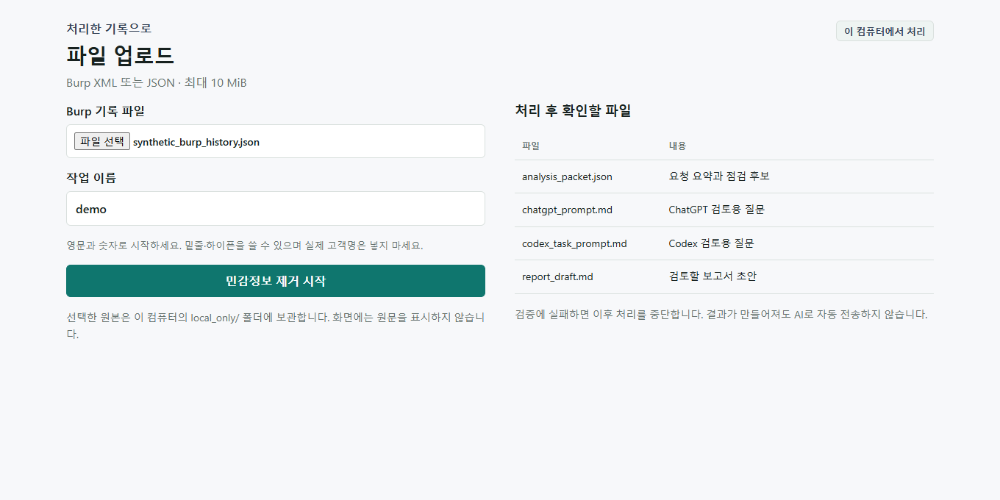
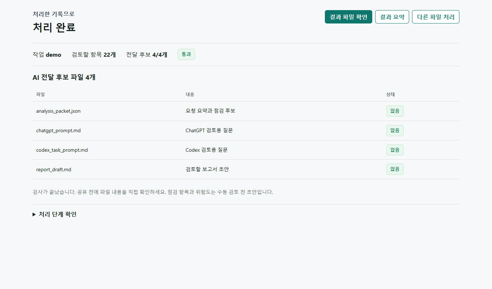
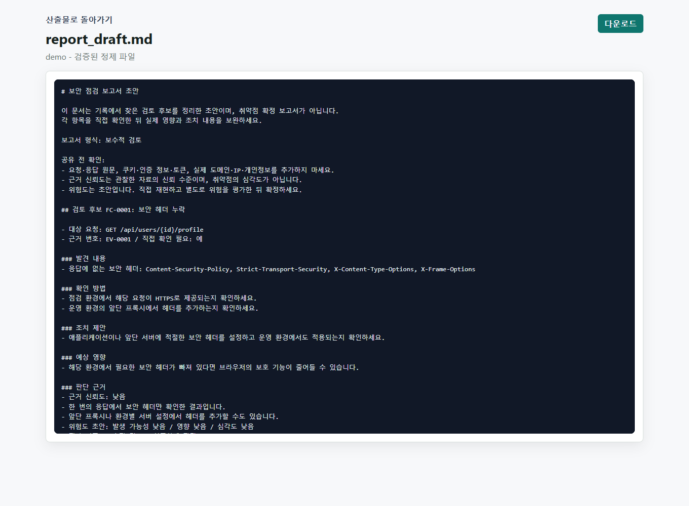
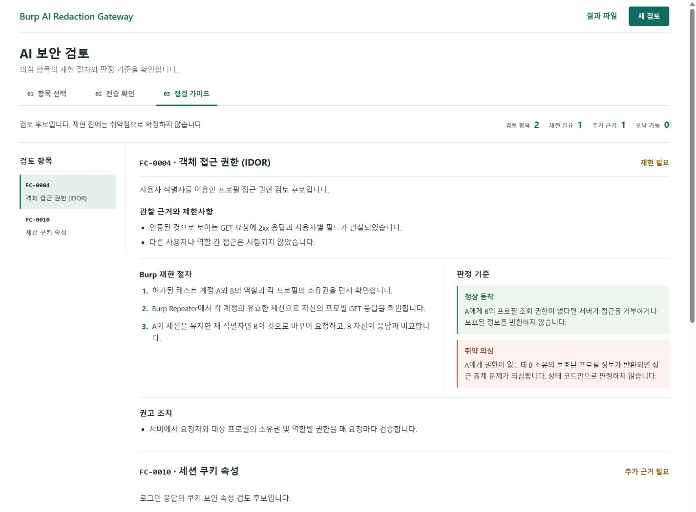

# Burp AI Redaction Gateway

Burp로 웹을 탐색하면 새 응답을 받아 민감정보를 가리고, 확인할 보안 항목과 보고서 초안을 만드는 로컬 도구입니다.
Burp 확장의 자동 수집이나 파일 업로드를 사용할 수 있습니다. 처리는 내 컴퓨터에서 진행하며, AI에 자동으로 보내지 않습니다.

| 사용 방식 | 할 수 있는 일 |
| --- | --- |
| [Burp 확장 자동 수집](#burp에서-자동으로-수집하기) | 새 Proxy 응답 수집, 마스킹, VA 분류와 보고서 자동 생성 |
| [웹 대시보드(GUI)](#시작하기) | 파일 업로드, 결과 확인, AI 점검 가이드 보기 |
| [터미널(CUI)](docs/AI_REVIEW.md#터미널에서-사용하기) | 후보 목록 조회, 전송 전 확인, 동의 후 AI 검토 |
| [Codex 대화(MCP)](docs/READ_ONLY_MCP.md) | 마스킹된 후보와 보고서를 대화에서 읽기 |

## 시작하기

Windows에서 처음 실행하는 순서입니다. 추가 Python 패키지 설치는 필요 없습니다.

1. [Python 3.12 이상](https://www.python.org/downloads/)을 설치합니다. 이미 설치했다면 건너뛰세요.
2. 이 페이지 위쪽의 Code → Download ZIP으로 내려받아 압축을 풉니다.
3. 압축을 푼 폴더 중 README.md가 있는 폴더를 엽니다. 탐색기 주소창에 `powershell`을 입력하고 Enter를 누릅니다.
4. 아래 명령을 실행합니다. `out`에 기존 결과가 있어도 지우지 않습니다.

```powershell
python -m burp_ai_redaction_gateway capture --open
```

터미널 창은 닫지 마세요. 브라우저가 자동으로 열리며, 열리지 않으면 아래 대시보드 링크를 누르면 됩니다.

## Burp에서 자동으로 수집하기

1. [수집기 설치 안내](docs/MONTOYA_COLLECTOR.md)에 따라 확장 JAR를 만들고 Burp에 추가합니다. 설치는 처음 한 번만 하면 됩니다.
2. Burp의 Scope에 허가받은 대상만 등록합니다.
3. 로컬 보안 점검 탭에서 자동 수집 시작을 누른 뒤, Burp Proxy를 통해 웹을 탐색합니다.
4. [자동 수집 결과](http://127.0.0.1:8766/burp)에서 새 결과를 확인합니다. 5초마다 갱신되며, 결과 보기에서 후보·확인 방법·조치 제안을 읽습니다.

Export나 매번 전송 버튼을 누를 필요는 없습니다. 시작 이후 범위 안의 새 Proxy 응답만 수집하며 과거 기록은 자동으로 가져오지 않습니다.
원문은 로컬 수신기에서 메모리로 처리하고, 검증한 결과만 저장합니다. 요청 재전송·능동 스캔은 하지 않습니다.
확장의 중지로 수집을 멈춥니다. 터미널에서 `Ctrl+C`를 누르면 수신기와 대시보드가 함께 종료됩니다.

## 파일로 처리하기

1. 브라우저에서 [대시보드](http://127.0.0.1:8766/)를 열고 파일 업로드를 누릅니다.
2. 처음에는 내려받은 폴더의 `samples/synthetic_burp_history.json`을 선택하고, 작업 이름에 `demo`를 입력하세요. 내 기록은 Burp에서 필요한 요청을 XML로 저장해 올리면 됩니다.
3. 민감정보 제거 시작을 누른 뒤 결과 파일 확인에서 내용을 읽고 필요한 파일만 내려받습니다.

다시 처리할 때는 `demo2`처럼 새 작업 이름을 쓰세요. 웹 업로드는 Burp XML·JSON, 최대 10 MiB(약 10.5 MB)입니다.
원본은 내 컴퓨터의 `local_only/`에 보관됩니다. 종료하려면 터미널에서 `Ctrl+C`를 누르세요.

<details>
<summary>실행되지 않을 때</summary>

- `python`을 찾을 수 없으면 Python 설치 후 터미널을 다시 여세요. `py --version`이 3.12 이상이면 실행 명령의 `python`을 `py`로 바꿔도 됩니다.
- `No module named burp_ai_redaction_gateway`가 나오면 README.md가 있는 폴더에서 실행했는지 확인하세요.
- 주소가 이미 사용 중이라면 `--port 8766`을 `--port 8767`로 바꾸고 브라우저에서도 `http://127.0.0.1:8767/`을 여세요.

</details>

## 결과 파일

| 파일 | 내용 |
| --- | --- |
| `report_draft.md` | 발견 내용과 확인 방법을 정리한 한글 보고서 초안 |
| `chatgpt_prompt.md` | 후보별 발견 내용과 확인 방법을 담은 ChatGPT 검토 요청 |
| `codex_task_prompt.md` | 후보별 발견 내용과 확인 방법을 담은 Codex 검토 요청 |
| `analysis_packet.json` | 상세 근거와 위험도 초안을 보존한 분석 데이터 |

프롬프트에는 긴 JSON 대신 한글 요약이 들어 있습니다. 상세 자료가 필요할 때만 `analysis_packet.json`에서 내용을 확인하세요.

검증에 실패하면 처리를 중단합니다. 다만 자동 검사가 모든 민감정보를 찾는 것은 아닙니다.
공유 전에 파일 내용을 직접 확인하고, 원본이나 결과 폴더 전체를 AI에 올리지 마세요.
점검 항목과 위험도는 초안이며 실제 취약점 여부는 별도로 확인해야 합니다.

## 실행 화면

공개 가상 샘플을 로컬에서 직접 처리한 [한글 보고서](docs/examples/report_draft.md) · [ChatGPT용 프롬프트](docs/examples/chatgpt_prompt.md) · [Codex용 프롬프트](docs/examples/codex_task_prompt.md) 예제입니다. 아래 사진도 실제 실행 화면이며, 실제 고객 기록은 사용하지 않았습니다.



<details>
<summary>처리 결과 보기</summary>



가상 요청 10개에서 검토 후보 22개가 나왔습니다. 후보 수는 확정 취약점 수가 아닙니다.

보고서는 후보마다 발견 내용 → 확인 방법 → 조치 제안 순서로 읽습니다. 공통 주의사항은 끝에 모았습니다.



</details>

## 대시보드에서 AI 검토 (선택)

결과 파일 확인 → AI 검토에서 후보를 1~5개 선택하고 전송할 내용 확인을 누릅니다.

- ChatGPT 구독(기본): 표시된 자료를 읽고 복사해 ChatGPT 대화에 붙여넣습니다. 다른 모델을 쓰려면 다른 모델의 대화창을 선택하세요. 답변은 해당 대화에서 받으며 게이트웨이는 API를 호출하지 않습니다.
- OpenAI API: 대시보드에서 답을 받으려면 API 모델을 고릅니다. 전송 자료를 확인하고 동의한 경우에만 요청합니다.

아래는 가상 샘플의 접근 권한·쿠키 설정 후보 2개를 실제 OpenAI API로 검토한 화면입니다.
AI가 취약점을 재현한 결과는 아니며, 최종 판정은 직접 해야 합니다. API 이용 요금은 별도입니다.



[가상 샘플 결과와 점검 방법](docs/examples/ai_review.md) · [키 연결과 사용 순서](docs/AI_REVIEW.md)

API의 기본 모델은 GPT-6 Luna입니다. 필요하면 GPT-6.1 Terra를 선택할 수 있습니다. 대화창을 쓸 때는 해당 서비스에서 모델을 선택합니다.

결과는 [VA-01~VA-30 점검 분류](docs/VA_CHECKLIST.md)에 맞춰 읽을 수 있습니다. 분류 미정·참고 분류·미점검 항목을 취약점 확정이나 정상 판정으로 보지 마세요.

## Codex 앱에서 읽기 (선택)

1. [MCP 설정 안내](docs/READ_ONLY_MCP.md)에서 가상 샘플 연결 방법과 FC-0010 실제 조회 예시를 확인하세요.
2. Codex 앱의 설정 → MCP servers → burp_sample → Restart(다시 시작)를 누릅니다. 대화 입력창의 `/mcp`에서 연결을 확인하세요.
3. “burp_sample에서 demo의 점검 후보 목록과 보고서 초안을 실제 MCP 도구로 읽어줘”라고 요청합니다.

앱 대화에서 검토 후보 22개와 한글 보고서 초안을 직접 조회했습니다. 조회할 때 CLI나 별도 서버 터미널은 필요 없습니다.
요청한 결과가 Codex에 전달되므로 공유해도 되는 자료인지 먼저 확인하세요. 확정 취약점이 아닌 검토 후보입니다.

Burp 기록은 수집기로 가져와 로컬에서 마스킹한 뒤 대시보드나 MCP에서 읽습니다. 공식 Burp MCP에 직접 연결해 원본을 읽거나 요청을 실행하는 방식은 아닙니다.

## 더 알아보기

- [사용 방법과 오류 해결](docs/USAGE.md): 내 Burp 기록 처리, 명령어 실행, 입력 형식
- [Burp에서 후보 확인하기](docs/BURP_MANUAL_CHECKS.md): 테스트 계정 A·B로 따라 하는 점검 순서와 판단 기준
- [결과 파일 안내](docs/OUTPUT_BUNDLE_GUIDE_KO_v0.6.md): 공유 전 확인할 내용
- 선택 설정: [Burp 수집기](docs/MONTOYA_COLLECTOR.md) · [Codex·읽기 전용 MCP 연결](docs/READ_ONLY_MCP.md)
- [프로젝트 요약](docs/PORTFOLIO_SUMMARY_KO.md) · [구성과 추가 설정](docs/REFERENCE.md)

Burp 수집기와 MCP는 기본 파일 처리에 필요하지 않습니다.
MCP는 검증된 결과를 읽는 연결이며 Burp를 직접 조작하지 않습니다.
원본 HTTP 조회, 요청 재전송, 능동 스캔은 제공하지 않습니다.
