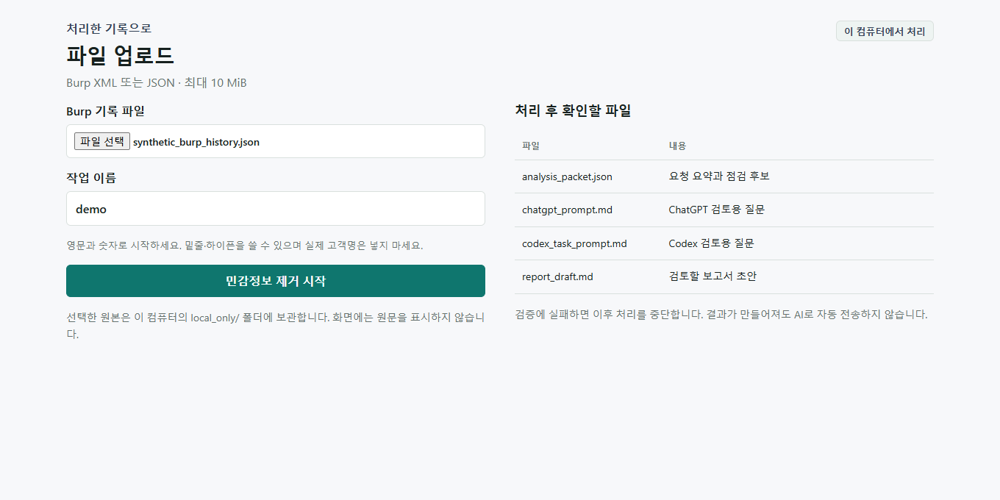
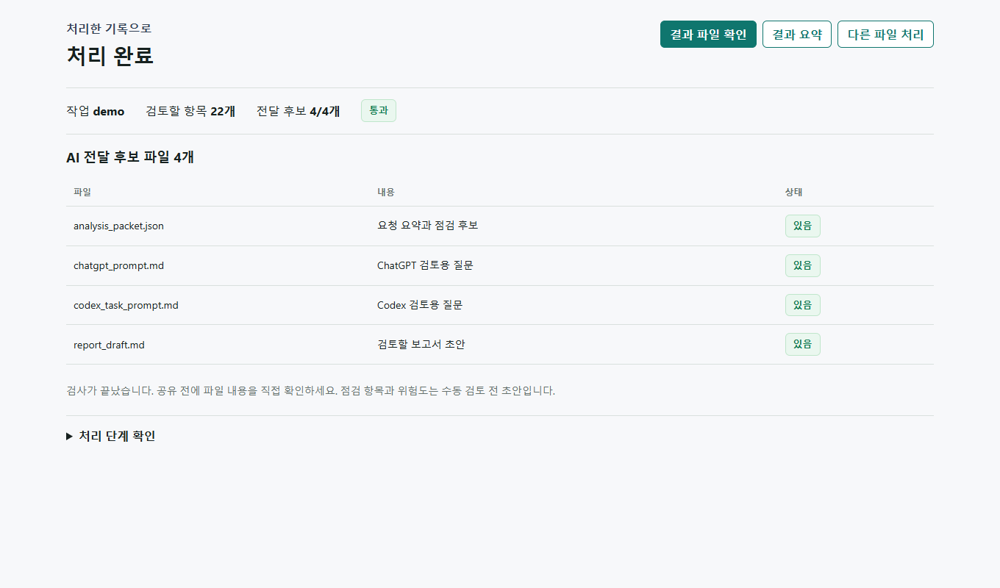
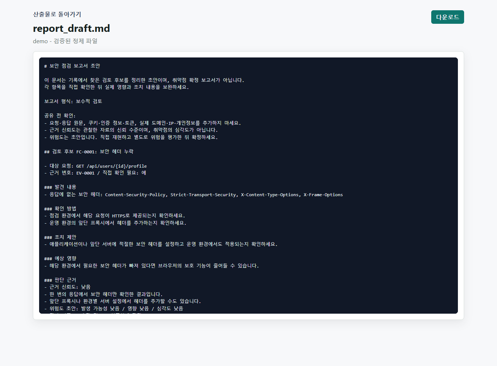

# Burp AI Redaction Gateway

**Burp 기록에서 민감정보를 가리고, AI 검토에 쓸 파일 4개를 만드는 로컬 도구입니다.**
쿠키·로그인 토큰·개인정보를 정리하고 보고서 초안을 만듭니다. 처리는 내 컴퓨터에서 진행하며, AI에 자동으로 보내지 않습니다.

## 시작하기

Windows에서 처음 실행하는 순서입니다. 추가 Python 패키지 설치는 필요 없습니다.

1. [Python 3.12 이상](https://www.python.org/downloads/)을 설치합니다. 이미 설치했다면 건너뛰세요.
2. 이 페이지 위쪽의 **Code → Download ZIP**으로 내려받아 압축을 풉니다.
3. 압축을 푼 폴더 중 **README.md가 있는 폴더**를 엽니다. 탐색기 주소창에 `powershell`을 입력하고 Enter를 누릅니다.
4. 열린 창에서 아래 두 줄을 순서대로 실행합니다. `out`은 결과를 저장할 폴더이며, 이미 있어도 그대로 사용합니다.

```powershell
New-Item -ItemType Directory -Force out
python -m burp_ai_redaction_gateway dashboard --host 127.0.0.1 --port 8766 --root out
```

터미널 창은 닫지 말고 브라우저를 여세요.

## 파일 처리하기

1. 브라우저에서 [대시보드](http://127.0.0.1:8766/)를 열고 **파일 업로드**를 누릅니다.
2. 처음에는 내려받은 폴더의 `samples/synthetic_burp_history.json`을 선택하고, 작업 이름에 `demo`를 입력하세요. 내 기록은 Burp에서 필요한 요청을 XML로 저장해 올리면 됩니다.
3. **민감정보 제거 시작**을 누른 뒤 **결과 파일 확인**에서 내용을 읽고 필요한 파일만 내려받습니다.

다시 처리할 때는 `demo2`처럼 새 작업 이름을 쓰세요. 웹 업로드는 Burp XML·JSON, 최대 10 MiB입니다.
원본은 내 컴퓨터의 `local_only/`에 보관됩니다. 종료하려면 터미널에서 `Ctrl+C`를 누르세요.

<details>
<summary>실행되지 않을 때</summary>

- `python`을 찾을 수 없으면 Python 설치 후 터미널을 다시 여세요. `py --version`이 3.12 이상이면 실행 명령의 `python`을 `py`로 바꿔도 됩니다.
- `No module named burp_ai_redaction_gateway`가 나오면 README.md가 있는 폴더에서 실행했는지 확인하세요.
- 주소가 이미 사용 중이라면 `--port 8766`을 `--port 8767`로 바꾸고 브라우저에서도 `http://127.0.0.1:8767/`을 여세요.

</details>

## 결과 파일

| 파일 | 내용 |
| --- | --- |
| `report_draft.md` | 발견 내용과 확인 방법을 정리한 한글 보고서 초안 |
| `chatgpt_prompt.md` | 후보별 발견 내용과 확인 방법을 담은 ChatGPT 검토 요청 |
| `codex_task_prompt.md` | 후보별 발견 내용과 확인 방법을 담은 Codex 검토 요청 |
| `analysis_packet.json` | 상세 근거와 위험도 초안을 보존한 분석 데이터 |

프롬프트에는 긴 JSON 대신 한글 요약이 들어 있습니다. 상세 자료가 필요할 때만 `analysis_packet.json`에서 내용을 확인하세요.

검증에 실패하면 처리를 중단합니다. 다만 자동 검사가 모든 민감정보를 찾는 것은 아닙니다.
**공유 전에 파일 내용을 직접 확인하고, 원본이나 결과 폴더 전체를 AI에 올리지 마세요.**
점검 항목과 위험도는 초안이며 실제 취약점 여부는 별도로 확인해야 합니다.

## 실행 화면

공개 가상 샘플을 로컬에서 직접 처리한 [한글 보고서](docs/examples/report_draft.md) · [ChatGPT용 프롬프트](docs/examples/chatgpt_prompt.md) · [Codex용 프롬프트](docs/examples/codex_task_prompt.md) 예제입니다. 아래 사진도 실제 실행 화면이며, 실제 고객 기록은 사용하지 않았습니다.



<details>
<summary>처리 결과 보기</summary>



가상 요청 10개에서 검토 후보 22개가 나왔습니다. 후보 수는 확정 취약점 수가 아닙니다.

보고서는 후보마다 **발견 내용 → 확인 방법 → 조치 제안** 순서로 읽습니다. 공통 주의사항은 끝에 모았습니다.



</details>

## 더 알아보기

- [사용 방법과 오류 해결](docs/USAGE.md): 내 Burp 기록 처리, 명령어 실행, 입력 형식
- [결과 파일 안내](docs/OUTPUT_BUNDLE_GUIDE_KO_v0.6.md): 공유 전 확인할 내용
- 선택 설정: [Burp 수집기](docs/MONTOYA_COLLECTOR.md) · [읽기 전용 MCP](docs/READ_ONLY_MCP.md)
- [프로젝트 요약](docs/PORTFOLIO_SUMMARY_KO.md) · [구성과 추가 설정](docs/REFERENCE.md)

Burp 수집기와 MCP는 기본 파일 처리에 필요하지 않습니다.
MCP는 검증된 결과를 읽는 연결이며 Burp를 직접 조작하지 않습니다.
원본 HTTP 조회, 요청 재전송, 능동 스캔은 제공하지 않습니다.
