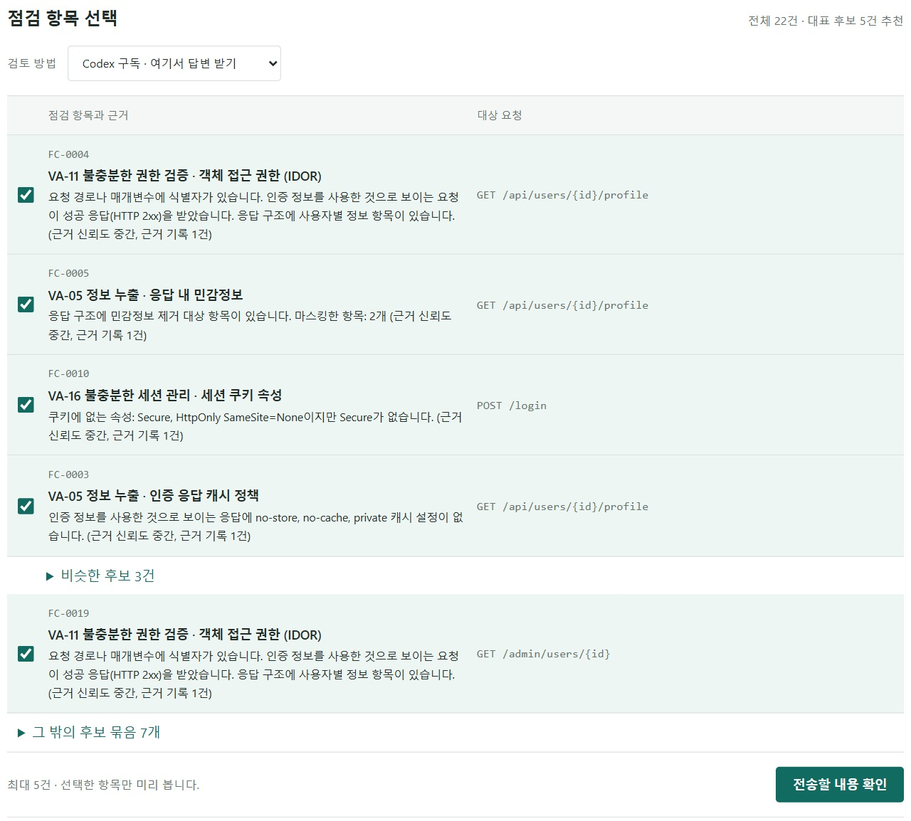
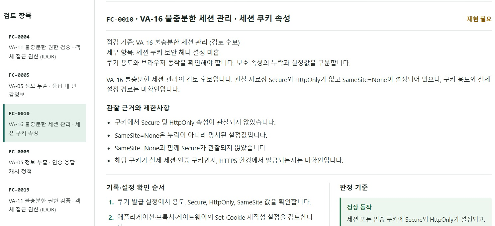

# 대시보드에서 AI 검토하기

마스킹한 점검 후보를 고르면 로그인한 Codex나 OpenAI API로 검토하고 같은 화면에서 답을 받을 수 있습니다.
확정 취약점을 찾거나 Burp를 대신 조작하는 기능은 아닙니다.

## 사용 순서

1. [파일 업로드](USAGE.md)나 [Burp 수집기](MONTOYA_COLLECTOR.md)로 기록을 처리한 뒤 결과 파일 확인 → AI 검토를 누릅니다.
2. 미리 선택된 대표 후보와 추천 근거를 봅니다. 바꾸려면 체크를 풀고 같은 묶음이나 다른 묶음에서 선택하세요. 검토 방법과 후보 1~5개를 확인하고 전송할 내용 확인을 누릅니다. 여기까지는 외부로 보내지 않습니다.
3. 선택한 방법에 따라 아래 순서로 검토합니다.

| 검토 방법 | 다음 단계 |
| --- | --- |
| Codex 구독 | 후보와 근거를 확인한 뒤 동의란을 선택하고 AI 검토 요청을 누릅니다. 답변에서 근거와 확인할 설정, 권고 조치를 읽습니다. |
| ChatGPT 대화창 | 자료를 직접 복사해 본인 대화에 붙여넣습니다. |
| 다른 모델의 대화창 | 승인된 서비스나 로컬 모델의 대화창에 직접 붙여넣습니다. 요금과 보관 정책은 모델 제공자에 따릅니다. |
| OpenAI API | 자료 전체를 읽고 외부 전송 동의란을 선택한 뒤 AI 검토 요청을 누릅니다. 답변을 대시보드에서 확인합니다. |

직접 복사하는 방식은 답변을 게이트웨이로 가져오지 않습니다. 어떤 방식을 쓰든 외부 공유가 허용되는지 먼저 확인하고 원본·키·추가 파일은 첨부하지 마세요.

## Codex 구독 연결

평소 쓰는 Codex의 개인 지침이 검토 자료에 섞이지 않도록 로그인 폴더를 분리합니다. Codex CLI를 설치한 뒤 새 PowerShell 창에서 아래 두 줄을 실행하고, 같은 ChatGPT 계정으로 한 번 로그인하세요.

```powershell
$env:CODEX_HOME = Join-Path $HOME '.burp-review-codex'
codex login
```

그 창에서 `codex login status`가 `Logged in using ChatGPT`이면 창을 닫아도 됩니다. macOS·Linux에서는 `CODEX_HOME="$HOME/.burp-review-codex" codex login`을 사용하세요. 이후 대시보드와 터미널은 이 로그인을 함께 사용하며, 기존 Codex 설정과 API 키는 건드리지 않습니다. 이 폴더에 개인 지침 파일을 넣지 마세요.

선택한 후보 번호·분류·근거만 검토합니다. 원본 패킷, 대상 경로, 쿠키 이름, 자유 입력 문장은 포함하지 않습니다. 답변은 후보 번호·형식·민감정보 검사를 통과해야 표시됩니다. 로그인이나 검토에 실패해도 API로 다시 보내지 않습니다.

가상 샘플로 구독 연결을 확인한 버전은 Codex CLI 0.144.1입니다.

## 가상 후보 5건의 점검 순서

[가상 샘플](../samples/synthetic_burp_history.json)에서 추천된 대표 후보 5건을 마스킹한 뒤 Codex 구독으로 검토했습니다. [터미널과 대시보드에서 모두 답변을 확인했습니다](https://github.com/ryuyunseong/burp-ai-redaction-gateway/pull/208#issuecomment-6962802874). 아래는 이 샘플에서 먼저 확인할 순서이며, 취약점 확정이나 심각도 순위가 아닙니다.



| 순서 | 확인할 항목 | 이유 |
| --- | --- | --- |
| 1 | 인증용 쿠키인지 (`FC-0010`) | `SameSite=None`은 설정돼 있고, 빠진 속성은 `Secure`와 `HttpOnly`입니다. 쿠키 용도를 알면 이 설정의 영향을 판단할 수 있습니다. |
| 2 | 요청자가 볼 수 있는 자료인지 (`FC-0004`, `FC-0019`) | 두 요청 모두 성공했고 응답에는 사용자별 정보 항목이 있었습니다. 성공 응답만으로는 요청자에게 그 자료를 볼 권한이 있었는지 알 수 없습니다. |
| 3 | 응답에 꼭 필요한 정보인지 (`FC-0005`) | 마스킹된 항목은 2개입니다. 두 항목이 요청자의 업무에 필요한지 확인해야 과도한 노출인지 판단할 수 있습니다. |
| 4 | 인증 응답의 캐시 설정 (`FC-0003`) | 응답에 `no-store`, `no-cache`, `private`가 없었습니다. 실제로 저장되거나 다른 사용자에게 공유됐다는 근거는 없습니다. |

왼쪽에서 후보 번호를 고르면 오른쪽에 해당 답변이 나옵니다. 다음은 `FC-0010`을 선택한 화면입니다.



## 결과 읽기

같은 작업 안에서 누락된 쿠키 속성이나 헤더 조합이 같으면 비슷한 설정으로 묶습니다. 접근 권한·민감정보·오류 응답은 마스킹된 요청이 같을 때만 묶습니다. 같은 묶음이라도 실제 원인이 같다는 뜻은 아닙니다.

묶음마다 근거 신뢰도, 서로 다른 관찰 항목 수, 근거 기록 수 순으로 대표를 고릅니다. 신뢰도가 같으면 여러 유형을 먼저 보여 줍니다. 번호가 빠른 후보는 조건이 같을 때만 우선합니다. 추천은 심각도나 취약 확정 순위가 아닙니다. 근거가 부족한 후보도 전체 목록에 남습니다.

| 항목 | 확인할 내용 |
| --- | --- |
| 관찰 근거와 제한사항 | 기록에서 확인한 사실과 아직 검증하지 못한 부분 |
| 기록·설정 확인 순서 | Codex 구독 답변에서 다음으로 살펴볼 기록과 설정 |
| 판정 기준 | 정상 동작과 취약점이 의심되는 결과의 차이 |
| 권고 조치 | 재현 결과에 따라 서버·쿠키 설정에서 보완할 내용 |

2026-11-17에 가상 요청 10개를 처리해 얻은 후보 22개 중 FC-0004·FC-0010을 실제 API로 검토했습니다.
[접근 권한·쿠키 설정 예제](examples/ai_review.md)에서 결과와 확인 방법을 읽을 수 있습니다.

상태의 재현 필요·추가 근거 필요·오탐 가능은 후속 점검 방향이며 심각도 등급이 아닙니다.
AI가 오탐 가능성을 제시해도 자동으로 후보를 삭제하지 않습니다. 허가된 테스트 자료와 업무 권한 정책을 기준으로 판단하세요.

점검 기준은 [VA-01~VA-30 분류](VA_CHECKLIST.md)를 사용합니다. 항목 선택 화면에서 전체 기준과 관련 후보·미점검 상태를 펼쳐 볼 수 있습니다.
VA 코드는 로컬 후보 유형에서 정합니다. CORS·캐시는 참고 분류, 보안 헤더 누락은 분류 미정이며, 전체 30개 항목의 진단 완료를 뜻하지 않습니다.
AI가 후보와 다른 VA 코드를 반환하면 표시를 중단합니다. 세부 항목이 미정이면 추측하지 않습니다.

## API 연결

OpenAI API 키가 연결된 환경에서 사용할 수 있습니다. 키가 없으면 전송 버튼이 비활성화됩니다.
키가 없다면 [OpenAI 키 관리 화면](https://platform.openai.com/settings/organization/api-keys)에서 사용할 프로젝트를 선택하고 새 키를 발급하세요. 저장소 폴더에 `.env.local` 파일을 만들고 `OPENAI_API_KEY=발급받은키`를 한 줄로 저장합니다. 이 파일은 Git에서 제외됩니다.
서버는 `OPENAI_API_KEY` 환경변수나 프로젝트의 로컬 전용 `.env.local`에서 키를 읽습니다. 키는 브라우저에 입력하거나 화면에 표시하지 않습니다. 키 값을 채팅, GitHub, 화면 사진에 넣지 마세요.

기본 모델은 GPT-6 Luna입니다. GPT-6.1 Terra가 필요할 때만 점검 항목 선택 화면에서 바꾸세요. 전송 확인 후에는 모델을 바꿀 수 없습니다. ChatGPT 구독과 API 이용 요금은 별도입니다.

| 모델 | 용도 | 입력 / 출력 100만 토큰당 |
| --- | --- | --- |
| [GPT-6 Luna](https://developers.openai.com/api/docs/models/gpt-6-luna) | 기본 선택 | $0.10 / $0.50 |
| [GPT-6.1 Terra](https://developers.openai.com/api/docs/models/gpt-6.1-terra) | 필요할 때 직접 선택 | $1 / $5 |

2026-11-17 공식 표준 텍스트 단가입니다. 실제 요금은 사용량과 적용 요율에 따라 달라지며, 같은 토큰 수에서 Luna 단가는 Terra의 10%입니다. 두 모델의 점검 정확도가 같다는 뜻은 아닙니다.
가상 후보 2개로 Terra의 대시보드 검토와 Luna의 터미널 검토를 직접 실행했습니다. 이 예제는 전체 보안 점검 정확도를 비교한 시험은 아닙니다.
선택한 모델을 계정에서 사용할 수 있어야 합니다. [남은 크레딧은 OpenAI 결제 화면](https://platform.openai.com/settings/organization/billing/overview)에서 확인하세요. 이 도구는 잔액이나 결제 설정을 변경하지 않습니다.

## 터미널에서 사용하기

이미 처리한 `out/demo`를 예로 듭니다. 후보 번호를 생략하면 추천 이유와 실제 전송할 자료를 보여 줍니다. 미리보기에는 API 키나 Codex 로그인이 필요하지 않습니다.

```powershell
python -m burp_ai_redaction_gateway ai-review --input out/demo --via codex
```

전체 묶음과 후보 번호는 `--list`로 봅니다. 다른 후보를 검토하려면 `--candidate FC-0010`처럼 지정하세요. 직접 지정한 목록이 추천을 대체하며 자동으로 다른 후보가 추가되지는 않습니다. 추천대로 구독 검토를 요청하려면 아래 명령에서 전송 자료를 읽고 `SEND`를 입력하세요.

```powershell
python -m burp_ai_redaction_gateway ai-review --input out/demo --via codex --send
```

대화창에 직접 붙여넣을 자료만 필요하면 아래처럼 실행합니다. 다른 서비스는 `--via other`를 사용하세요.

```powershell
python -m burp_ai_redaction_gateway ai-review --input out/demo --candidate FC-0010 --via chatgpt
```

기존 API를 사용하려면 아래처럼 실행합니다. 전체 전송 내용을 읽고 직접 연 터미널에서 `SEND`를 입력해야 전송됩니다. 취소하면 보내지 않습니다.

```powershell
python -m burp_ai_redaction_gateway ai-review --input out/demo --candidate FC-0010 --send
```

`--candidate FC-0004`처럼 옵션을 반복하면 최대 5개를 함께 검토합니다. `--send`를 빼면 미리보기만 합니다.
GPT-6.1 Terra가 필요하면 같은 명령에 `--model gpt-6.1-terra`를 붙입니다. 기본 모델을 명시하려면 `--model gpt-6-luna`를 씁니다. 결과는 한글로 출력되며 기존 파일 4개를 바꾸지 않습니다.

## Burp·Codex MCP에서 사용하기

`Burp 수집기 → 로컬 마스킹·검증 → 대시보드 또는 Codex(MCP)` 순서입니다.
기록 가져오기는 [수집기 안내](MONTOYA_COLLECTOR.md), 대화에서 읽기는 [MCP 연결 안내](READ_ONLY_MCP.md)를 따르세요.

이미 `burp_sample`을 연결했다면 Codex에서 “burp_sample의 demo에서 FC-0010과 보고서를 읽고, 재현 절차와 판정 기준을 정리해줘”라고 요청합니다.
MCP 조회 자체는 이 프로젝트의 OpenAI API 키를 사용하지 않습니다. Codex 등 연결한 프로그램의 모델 이용 요금·한도와 공유 정책은 별도입니다.

공식 Burp MCP에 원본을 직접 전달하는 연동이나 자동 재전송·능동 스캔은 추가하지 않습니다. 기존 MCP 설정과 허용 폴더도 자동으로 바꾸지 않습니다.

## 직접 API 사용 시 전송과 보관

- 선택한 후보의 번호, 유형, 마스킹된 대상 요청, 근거 번호와 설명만 보냅니다. 작업 이름, 로컬 파일 경로, 원본 요청·응답, 다른 후보는 보내지 않습니다.
- 전송 직전에 민감정보와 파일 변경 여부를 다시 검사합니다. AI 응답도 형식과 민감정보 검사를 통과한 내용만 표시합니다.
- AI에 도구 실행, 파일 읽기, 웹 검색 권한을 주지 않습니다. 재전송과 능동 스캔은 실행하지 않습니다.
- AI 결과는 대시보드 메모리에만 보관하며 종료하면 사라집니다. 기존 결과 파일 4개는 바꾸지 않습니다.
- API 응답 저장은 `store=false`로 끕니다. 다만 [OpenAI의 보안 점검용 로그 보관](https://developers.openai.com/api/docs/guides/your-data)까지 없애는 설정은 아닙니다. 회사의 외부 전송 정책을 먼저 확인하세요.

자동 마스킹과 검사가 모든 민감정보를 찾는 것은 아닙니다. 전송 전 내용을 직접 확인해야 합니다.

## 요청이 중단될 때

| 화면 안내 | 확인할 내용 |
| --- | --- |
| API 키 연결이 준비되지 않음 | 서버의 API 연결 상태를 확인하세요. 키 값은 화면이나 로그에 남기지 마세요. |
| 민감정보 의심 내용 발견 | 마스킹 결과를 확인하고 기록을 다시 처리하세요. 검사를 끄지 마세요. |
| 확인 이후 파일이 바뀜 | 후보를 다시 선택하고 전송 내용을 확인하세요. |
| 이용 한도 도달 | OpenAI 계정의 이용량과 결제 상태를 확인하세요. |
| 응답 시간 초과·형식 오류 | 자동 재시도하지 않습니다. 이용량을 확인하고 필요하면 후보 수를 줄여 새로 요청하세요. |

[대시보드 시작 방법](../README.md#시작하기)
