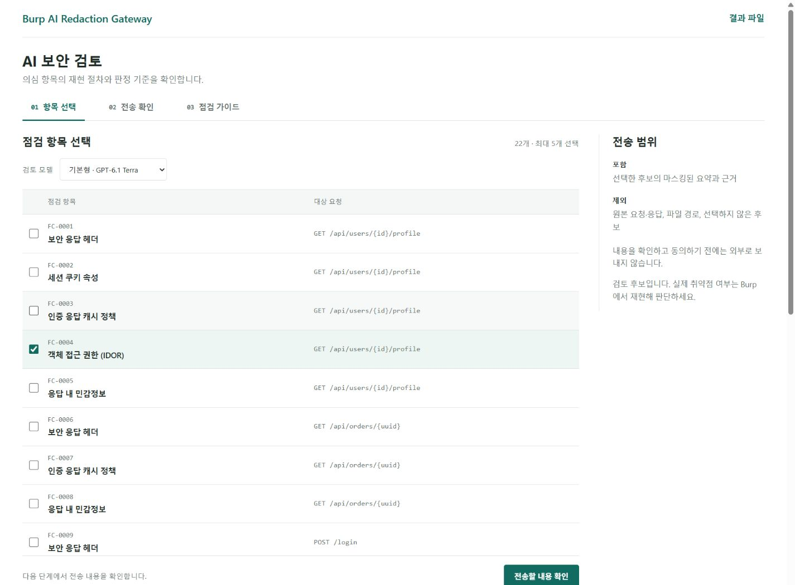
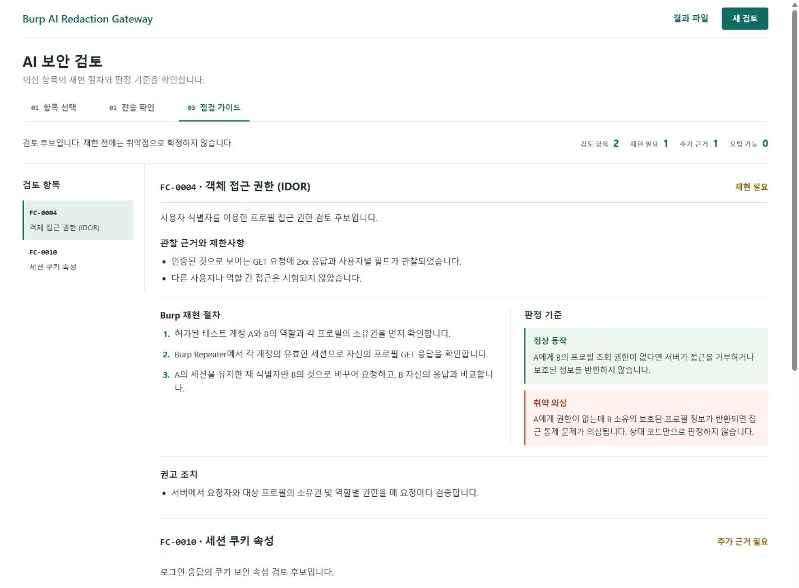

# 대시보드에서 AI 검토하기

마스킹한 점검 후보를 OpenAI에 보내 Burp 재현 절차, 판정 기준, 권고 조치를 받습니다.
확정 취약점을 찾거나 Burp를 대신 조작하는 기능은 아닙니다.

## 사용 순서

1. [파일 업로드](USAGE.md)나 [Burp 수집기](MONTOYA_COLLECTOR.md)로 기록을 처리한 뒤 결과 파일 확인 → AI 검토를 누릅니다.
2. 점검할 후보를 1~5개 선택하고 전송할 내용 확인을 누릅니다. 여기까지는 외부로 보내지 않습니다.
3. 실제로 전송할 자료 전체를 펼쳐 읽습니다. 외부로 보내도 되는 내용인지 확인한 뒤 동의란을 선택하고 AI 검토 요청을 누릅니다.



## 결과 읽기

| 항목 | 확인할 내용 |
| --- | --- |
| 관찰 근거와 제한사항 | 기록에서 확인한 사실과 아직 검증하지 못한 부분 |
| Burp 재현 절차 | 테스트 계정과 요청을 비교할 순서 |
| 판정 기준 | 정상 동작과 취약점이 의심되는 결과의 차이 |
| 권고 조치 | 재현 결과에 따라 서버·쿠키 설정에서 보완할 내용 |



2026-11-17에 가상 요청 10개를 처리해 얻은 후보 22개 중 FC-0004·FC-0010을 실제 API로 검토했습니다.
[접근 권한·쿠키 설정 예제](examples/ai_review.md)에서 결과와 확인 방법을 읽을 수 있습니다.

상태의 재현 필요·추가 근거 필요·오탐 가능은 후속 점검 방향이며 심각도 등급이 아닙니다.
AI가 오탐 가능성을 제시해도 자동으로 후보를 삭제하지 않습니다. 허가된 테스트 자료와 업무 권한 정책을 기준으로 판단하세요.

## API 연결

OpenAI API 키가 연결된 환경에서 사용할 수 있습니다. 키가 없으면 전송 버튼이 비활성화됩니다.
키가 없다면 [OpenAI 키 관리 화면](https://platform.openai.com/settings/organization/api-keys)에서 사용할 프로젝트를 선택하고 새 키를 발급하세요. 저장소 폴더에 `.env.local` 파일을 만들고 `OPENAI_API_KEY=발급받은키`를 한 줄로 저장합니다. 이 파일은 Git에서 제외됩니다.
서버는 `OPENAI_API_KEY` 환경변수나 프로젝트의 로컬 전용 `.env.local`에서 키를 읽습니다. 키는 브라우저에 입력하거나 화면에 표시하지 않습니다. 키 값을 채팅, GitHub, 화면 사진에 넣지 마세요.

기본 모델은 GPT-6.1 Terra입니다. 점검 항목 선택 화면에서만 모델을 고르며, 전송 확인 후에는 모델을 바꿀 수 없습니다. ChatGPT 구독과 API 이용 요금은 별도입니다.

| 모델 | 용도 | 입력 / 출력 100만 토큰당 |
| --- | --- | --- |
| [GPT-6.1 Terra](https://developers.openai.com/api/docs/models/gpt-6.1-terra) | 기본 선택 | $1 / $5 |
| [GPT-6 Luna](https://developers.openai.com/api/docs/models/gpt-6-luna) | 반복 점검용 저비용 선택 | $0.10 / $0.50 |

2026-11-17 공식 표준 텍스트 단가입니다. 실제 요금은 사용량과 적용 요율에 따라 달라지며, 같은 토큰 수에서 Luna 단가는 Terra의 10%입니다. 두 모델의 점검 정확도가 같다는 뜻은 아닙니다.
가상 후보 2개로 Terra의 대시보드 검토와 Luna의 터미널 검토를 직접 실행했습니다. 이 예제는 전체 보안 점검 정확도를 비교한 시험은 아닙니다.
선택한 모델을 계정에서 사용할 수 있어야 합니다. [남은 크레딧은 OpenAI 결제 화면](https://platform.openai.com/settings/organization/billing/overview)에서 확인하세요. 이 도구는 잔액이나 결제 설정을 변경하지 않습니다.

## 터미널에서 사용하기

이미 처리한 `out/demo`를 예로 듭니다. 먼저 후보 목록을 확인합니다. API를 호출하지 않습니다.

```powershell
python -m burp_ai_redaction_gateway ai-review --input out/demo
```

후보 번호를 골라 요청합니다. 전체 전송 내용이 표시된 뒤 직접 연 터미널에서 `SEND`를 입력해야 전송됩니다. 취소하거나 입력하지 않으면 보내지 않습니다.

```powershell
python -m burp_ai_redaction_gateway ai-review --input out/demo --candidate FC-0010 --send
```

`--candidate FC-0004`처럼 옵션을 반복하면 최대 5개를 함께 검토합니다. `--send`를 빼면 미리보기만 합니다.
모델을 명시하려면 `--model gpt-6.1-terra` 또는 `--model gpt-6-luna`를 붙입니다. 결과는 한글로 출력되며 기존 파일 4개를 바꾸지 않습니다.

## Burp·Codex MCP에서 사용하기

`Burp 수집기 → 로컬 마스킹·검증 → 대시보드 또는 Codex(MCP)` 순서입니다.
기록 가져오기는 [수집기 안내](MONTOYA_COLLECTOR.md), 대화에서 읽기는 [MCP 연결 안내](READ_ONLY_MCP.md)를 따르세요.

이미 `burp_sample`을 연결했다면 Codex에서 “burp_sample의 demo에서 FC-0010과 보고서를 읽고, 재현 절차와 판정 기준을 정리해줘”라고 요청합니다.
MCP 조회 자체는 이 프로젝트의 OpenAI API 키를 사용하지 않습니다. Codex 등 연결한 프로그램의 모델 이용 요금·한도와 공유 정책은 별도입니다.

공식 Burp MCP에 원본을 직접 전달하는 연동이나 자동 재전송·능동 스캔은 추가하지 않습니다. 기존 MCP 설정과 허용 폴더도 자동으로 바꾸지 않습니다.

## 전송과 보관

- 선택한 후보의 번호, 유형, 마스킹된 대상 요청, 근거 번호와 설명만 보냅니다. 작업 이름, 로컬 파일 경로, 원본 요청·응답, 다른 후보는 보내지 않습니다.
- 전송 직전에 민감정보와 파일 변경 여부를 다시 검사합니다. AI 응답도 형식과 민감정보 검사를 통과한 내용만 표시합니다.
- AI에 도구 실행, 파일 읽기, 웹 검색 권한을 주지 않습니다. 재전송과 능동 스캔은 실행하지 않습니다.
- AI 결과는 대시보드 메모리에만 보관하며 종료하면 사라집니다. 기존 결과 파일 4개는 바꾸지 않습니다.
- API 응답 저장은 `store=false`로 끕니다. 다만 [OpenAI의 보안 점검용 로그 보관](https://developers.openai.com/api/docs/guides/your-data)까지 없애는 설정은 아닙니다. 회사의 외부 전송 정책을 먼저 확인하세요.

자동 마스킹과 검사가 모든 민감정보를 찾는 것은 아닙니다. 전송 전 내용을 직접 확인해야 합니다.

## 요청이 중단될 때

| 화면 안내 | 확인할 내용 |
| --- | --- |
| API 키 연결이 준비되지 않음 | 서버의 API 연결 상태를 확인하세요. 키 값은 화면이나 로그에 남기지 마세요. |
| 민감정보 의심 내용 발견 | 마스킹 결과를 확인하고 기록을 다시 처리하세요. 검사를 끄지 마세요. |
| 확인 이후 파일이 바뀜 | 후보를 다시 선택하고 전송 내용을 확인하세요. |
| 이용 한도 도달 | OpenAI 계정의 이용량과 결제 상태를 확인하세요. |
| 응답 시간 초과·형식 오류 | 자동 재시도하지 않습니다. 이용량을 확인하고 필요하면 후보 수를 줄여 새로 요청하세요. |

[대시보드 시작 방법](../README.md#시작하기)
