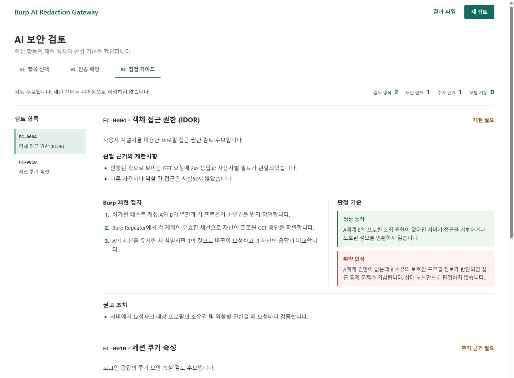

# AI 검토 예제: 접근 권한과 쿠키 설정

[공개 가상 샘플](../../samples/synthetic_burp_history.json)의 요청 10개에서 검토 후보 22개가 나왔습니다.
그중 FC-0004·FC-0010을 2026-11-17에 OpenAI API의 `gpt-6.1-terra`로 검토했습니다.
아래는 실제 응답을 점검 절차와 판정 기준 중심으로 요약한 내용입니다.

실제 고객 자료는 사용하지 않았습니다. AI 호출과 화면 표시는 확인했지만, 가상 서비스의 취약점을 직접 재현한 결과는 아닙니다.

## FC-0004: 객체 접근 권한 (IDOR)

- AI 상태: 재현 필요
- 관찰 내용: 사용자 식별자가 포함된 요청에서 성공 응답과 사용자별 정보 항목이 확인됐습니다.
- 미확인 사항: 다른 계정의 보호된 자료까지 조회할 수 있는지는 검증되지 않았습니다. 성공 응답만으로 권한 우회를 판단할 수 없습니다.

### Burp 재현 절차

서로의 비공개 자료를 조회할 권한이 없는 테스트 계정 A·B를 가정한 예시입니다. 실제 서비스에서는 업무 권한 정책부터 확인하세요.

1. A와 B의 역할·자료 소유권을 확인하고, 각 계정으로 자신의 자료를 조회한 응답을 준비합니다.
2. A의 조회 요청을 Burp Repeater로 보냅니다. A의 세션은 유지하고 식별자만 B의 테스트 자료로 바꿉니다.
3. B의 세션에서도 A의 테스트 자료로 같은 비교를 합니다.
4. 상태 코드뿐 아니라 보호된 내용과 반환 범위를 원래 소유자의 응답과 비교합니다. 관찰된 조회 요청만 사용하며 수정·삭제 요청으로 바꾸지 않습니다.

### 판정 기준과 권고 조치

| 구분 | 기준 |
| --- | --- |
| 정상 동작 | 권한이 없는 자료를 거부하거나 보호된 내용을 반환하지 않음 |
| 취약 의심 | 업무 권한 정책상 허용되지 않은 계정에 다른 사용자의 보호된 내용이 반환됨 |
| 권고 조치 | 서버에서 매 요청의 소유권·역할을 검사하고, 계정 간 교차 접근을 회귀 테스트에 추가 |

다른 소유자의 자료라도 정책상 공유된 자료라면 조회 자체만으로 문제라고 판단하지 않습니다.

## FC-0010: 세션 쿠키 속성

- AI 상태: 추가 근거 필요
- 관찰 내용: 쿠키 속성 정보에 Secure·HttpOnly 누락과 SameSite=None 설정이 함께 기록됐습니다. 쿠키 값은 전송하지 않았습니다.
- 미확인 사항: 해당 쿠키가 실제 인증·세션 유지에 쓰이는지, 브라우저가 어떻게 처리하는지 확인해야 합니다.

### Burp 재현 절차

1. 허가된 테스트 계정으로 로그인하고 Burp에서 응답의 Set-Cookie 속성만 확인합니다. 쿠키 값은 공유하지 않습니다.
2. 브라우저 개발자 도구의 쿠키 저장소에서 인증·세션에 사용하는 쿠키인지와 Secure·HttpOnly 표시를 확인합니다.
3. HTTPS 환경에서 SameSite=None과 Secure 누락 조합이 브라우저에서 차단되는지, 로그인 상태에 어떤 영향이 있는지 비교합니다.
4. 로그인·세션 갱신 응답에서도 속성이 일관되는지 확인합니다. 브라우저 보안 설정은 끄지 않습니다.

### 판정 기준과 권고 조치

| 구분 | 기준 |
| --- | --- |
| 정상 동작 | 인증·세션용 쿠키에 필요한 Secure·HttpOnly가 설정되고, SameSite=None 사용 시 Secure가 함께 있음 |
| 취약 의심 | 인증·세션용 쿠키의 보호 속성이 실제로 누락됐거나, 브라우저 정책과 맞지 않는 조합으로 동작에 문제가 있음 |
| 권고 조치 | 인증·세션용 쿠키에 Secure·HttpOnly를 적용하고, 교차 사이트 사용이 필요할 때만 SameSite=None과 Secure를 함께 사용 |

SameSite=None은 설정값이지 누락이 아닙니다. Secure 누락과 구분해서 봅니다.
브라우저의 쿠키 차단이나 속성 누락만으로 인증 우회·정보 유출이 확인됐다고 판단하지 않습니다.

[AI 연결과 사용 순서](../AI_REVIEW.md) · [Burp에서 후보 확인하기](../BURP_MANUAL_CHECKS.md)
