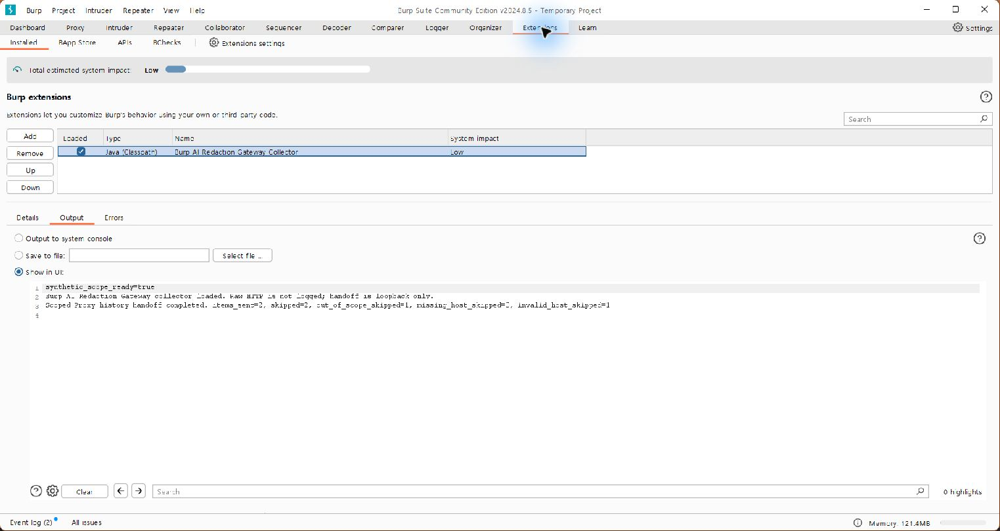
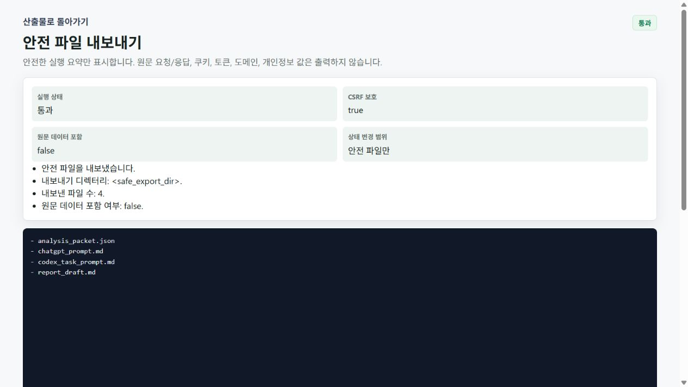

# Burp 수집기 실행 예제

2026-10-20, Windows에서 Burp Community 2024.8.5·JDK 21.0.1·Python 3.12.1로 확인했습니다.
외부 서비스나 실제 계정 대신 내 컴퓨터의 가상 응답 서버를 사용했습니다.

## 설치와 전송

문서의 JAR를 Extensions → Installed → Add에서 선택해 설치 성공과 빈 Errors 탭을 확인했습니다.
전송은 같은 JAR를 개발용 시작 옵션으로 불러온 별도 임시 프로젝트에서 수행했습니다. 가상 범위는 API로 등록하고 가상 호스트는 로컬 서버로만 연결했습니다.

- Proxy 기록 4건 중 범위 안 2건 전송
- 범위 밖 1건, IP 주소 1건 제외
- Output: `items_sent=2`, `skipped=2`, `out_of_scope_skipped=1`, `missing_host_skipped=0`, `invalid_host_skipped=1`

## 결과 확인

수신기를 종료한 뒤 검증을 통과했습니다. 대시보드에서 두 기록이 표시됐고 각각 검토 후보 5개가 나왔습니다. 확정 취약점 수가 아닙니다.
각 기록에서 보고서 다시 만들기와 파일 4개 내보내기를 실행했습니다. 두 보고서 모두 한글 검토 후보로 표시되며, 내보낸 파일도 민감정보 검사를 통과했습니다.
이미 사용 중인 기본 포트는 그대로 두고 별도 포트에서 확인했습니다. 기존 Burp 설정과 작업 기록은 사용하지 않았습니다.

[설치와 사용 방법으로 돌아가기](../MONTOYA_COLLECTOR.md)
